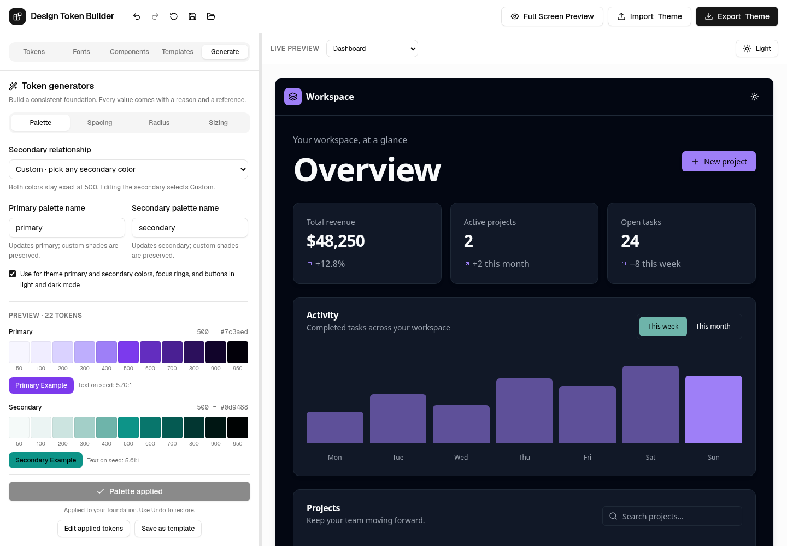

# Design Token Builder

Build Tailwind themes from editable foundation, semantic, and component tokens. Generate color palettes and dimension scales, then preview the result in light and dark mode across seven interactive layouts and an English and Thai typography preview.

Save reusable themes in your browser and export CSS, Tailwind configuration, JSON, or a `DESIGN.md` design contract.

[Run locally](#run-locally) · [Theme workflow](#create-and-refine-a-theme) · [Contributing](CONTRIBUTING.md) · [MIT License](LICENSE) · [Report an issue](https://github.com/isoonissalty/design-tokener/issues)

## Application screenshot



## Run locally

Requires Git, npm, and Node.js 26.13.1 (stable LTS). The repository pins this version in `.nvmrc` and `.node-version`. With [nvm](https://github.com/nvm-sh/nvm) installed:

```bash
git clone https://github.com/isoonissalty/design-tokener.git
cd design-tokener
nvm install
nvm use
npm ci
npm run dev
```

If you use another Node.js installation or version manager, select Node.js 26.13.1 before running the npm commands.

Open [http://localhost:3000](http://localhost:3000). The editor and preview resize side by side on desktop and stack vertically on smaller screens. No API keys, database, or environment variables are required for local development. Next.js fetches Geist fonts from Google during development and production builds, so allow network access for those requests.

## Token model

| Layer | Purpose | Examples |
| --- | --- | --- |
| Foundation | Base values used throughout a theme. | Color palettes, font families, spacing, sizing, radii, and border widths. |
| Semantic | Values assigned to a visual role, including light and dark colors. | Canvas backgrounds, primary text, intent colors, typography, shadows, and motion. |
| Component | Values for individual component styles. | Button backgrounds, interaction states, text, radius, and padding. |

Tokens can refer to other tokens with aliases such as `{color.blue.600}` or `{space.4}`. Edit the foundation value to update the tokens that reference it.

## Create and refine a theme

- **Templates:** see the current theme, save it under a name, or apply one of eight complete starting themes. Your templates persist in this browser and include every token, both color modes, typography, spacing, and button styles. Editing or applying another theme keeps saved templates intact.
- **Fonts:** open the top-level Fonts tab or the **Set up English & Thai fonts** shortcut in Tokens. Apply a recommended pairing in one click, or choose English and Thai fonts separately. Your first selection fills the other language with its recommended font. Changes apply immediately and are undoable. The **Typography · EN / TH** preview includes both scripts, mixed text, Thai marks, numbers, and an editable sample. Pairings update the sans-serif stack; custom serif/monospace roles retain their configured fonts. Catalog Google Fonts load automatically, with a visible fallback status when unavailable. Save the theme or a template to reuse your selections.
- **Generate:** build color palettes, spacing, corner radius, and content sizing. Color generation supports OKLCH, HSL, or encoded sRGB, with independent primary and secondary colors, named palettes, and optional harmony relationships. Generator drafts stay in place when switching tabs.
- **Tokens:** edit individual foundation and semantic values. After applying generated values, use **Edit applied tokens** to open the matching Foundation category. Generated color palettes appear expanded at the top of Colors. Use **Save as template** to name and save the full applied theme and its generation recipes in Templates.
- **Components:** customize button colors, interaction states, radius, and padding. Other listed components inherit the global tokens.
- **Preview:** choose Landing page, Dashboard, Pricing page, Settings & forms, Component gallery, Storefront, or Article / documentation. Toggle light/dark mode or open the selected layout in full screen. Example layouts adapt to the preview pane width.

Try form validation and preferences in Settings, inspect control and status styles in the gallery, filter products and adjust cart quantities in Storefront, or explore typography and code in the article. Sample interactions stay in the preview and reset when switching layouts or opening full screen; they do not change your theme or submit data.

Template, palette, import, reset, and saved-theme restoration are undoable. Undo/redo retains up to 100 changes. Ctrl/⌘ Z and Ctrl/⌘ Shift Z work outside text inputs. Use the header's **Save** and **Restore** controls to keep or reload a snapshot in this browser's local storage. Named templates are stored separately. Export JSON for a portable backup; clearing browser storage removes local saves and templates.

## Generated values and references

Open **Generate**, choose a method, inspect the preview and **Why these values?**, then apply. Every generated token includes its formula and linked sources. Each application is one undoable change and preserves other foundation tokens.

- **Palette:** both chosen colors stay exact at shade 500. Ramp weights and hue rotations are application recipes informed by [W3C color models](https://www.w3.org/TR/css-color-4/) and [color harmony concepts](https://color.adobe.com/create/color-wheel).
- **Spacing:** adjustable 4px or 8px grids, or the published [Carbon spacing scale](https://www.carbondesignsystem.com/building-blocks/foundations/spacing/overview).
- **Radius:** adjustable [Tailwind v3](https://v3.tailwindcss.com/docs/border-radius) or [Material Web v0_192](https://github.com/material-components/material-web/blob/main/tokens/versions/v0_192/_md-sys-shape.scss) presets. Zero and full rounding stay fixed.
- **Sizing:** adjustable content widths based on [Tailwind v3 max-widths](https://v3.tailwindcss.com/docs/max-width), with an independent container width.

Dimension generators support px/rem output using the root size in **Tokens → Settings**. Saved configurations and JSON exports preserve generation references; exported CSS includes them as comments. Manually edited values and subsequent root-size changes are distinguished from the original recipe.

## Import and export

**Import Theme** accepts a `.json`/`.css` file or pasted text. JSON restores the full token system. CSS merges recognized `:root`, `.dark`, and Tailwind `@theme` declarations into the current theme. Hex, HSL, RGB, and modern CSS color values remain editable. JavaScript configuration imports are not executed; use CSS or JSON instead.

**Export Theme** offers a code preview, copy, and download:

| Format | Usage |
| --- | --- |
| Tailwind CSS v4 | Use `theme.css` as your Tailwind stylesheet. It includes the Tailwind import, utility mappings, and dark variant. |
| Tailwind CSS v3 | Download both `theme.css` and `tailwind.config.cjs`. Import the CSS alongside your Tailwind directives and use the config's theme mappings. |
| JSON | Includes every token and both modes for exact restoration and further editing. |
| DESIGN.md | A self-contained design contract with the current tokens, both color modes, and usage guidance. Preview, copy, or download it for your project. |

The DESIGN.md export follows the Google DESIGN.md alpha format and its standard eight sections. It includes configured colors, typography, spacing, corner radii, and button states in YAML. Shadows, motion, sizing, borders, opacity, and layer order are documented in prose because the alpha schema has no fields for them. The document distinguishes observed values from proposed guidance and reports unresolved references. Product context and accessibility checks still need verification. Re-export after editing tokens to keep the contract current.

CSS imports update supported matching variables and retain the other tokens. JSON is the format for lossless backups. Review import errors in the dialog; an invalid import leaves the current theme intact.

Font selections travel with saved themes, templates, JSON, and CSS imports. CSS exports include the Google Fonts import and apply the body font; Tailwind v3 exports also map `font-en` and `font-th`. DESIGN.md includes the loading URL and language guidance. Keep English first, Thai second, and generic fallback last in the mixed-language stack. Imported custom font names need their own font files or loading setup.

## Development

Built with Next.js App Router, React, TypeScript, Redux Toolkit, Tailwind CSS v3, and Radix UI primitives. The editor exports themes for both Tailwind CSS v3 and v4.

| Command | Purpose |
| --- | --- |
| `npm run dev` | Start the development server. |
| `npm test` | Run the Node.js test suites against the TypeScript source. |
| `npm run typecheck` | Check TypeScript without emitting files. |
| `npm run lint` | Run ESLint. |
| `npm run build` | Create a production build. |
| `npm start` | Serve the production build after running `npm run build`. |

The Node test suite covers token reference generation, color preservation, palette/contrast behavior, immutable templates, import/export (including DESIGN.md structure and alias resolution), and undo/redo history. See [CONTRIBUTING.md](CONTRIBUTING.md) for the project structure, development workflow, and pull request checks.

## Dependency security

Run `npm ci` to install the audited lockfile and `npm audit --include=dev --audit-level=low` to check both runtime and development dependencies at every severity.

The scoped `@typescript-eslint/typescript-estree` override keeps its `minimatch` dependency on a patched 11.x release for [GHSA-g3hv-75wg-m249](https://github.com/advisories/GHSA-g3hv-75wg-m249). Remove the override when the upstream parser uses a patched version in its own dependency range.

## Contributing

Bug reports, documentation improvements, and code contributions are welcome. Read the [contributing guide](CONTRIBUTING.md) for setup instructions, coding conventions, and how to submit a pull request.

## License

This project is licensed under the [MIT License](LICENSE).
